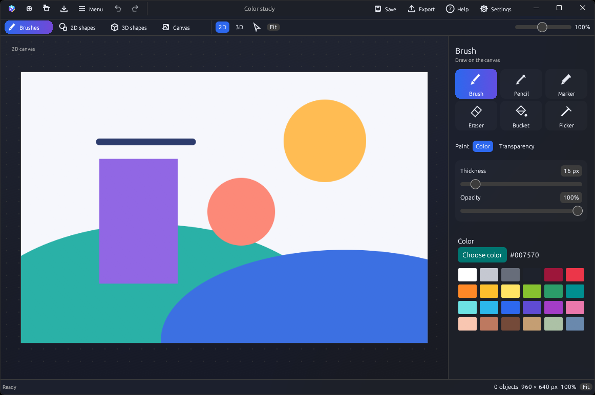

<p align="center"></p>
<h1 align="center">Ada3D</h1>
<p align="center">Draw in 2D. Create in 3D.<br/>By R3F Studio · GPLv3</p>



## Download

Download the package for Windows, macOS or Linux from [**Releases**](https://github.com/R3FStudio/Ada3D/releases).

- **Windows:** run the setup wizard, or extract the portable ZIP.
- **macOS:** open the PKG installer, or move **Ada3D.app** from the ZIP to Applications.
- **Linux:** open the DEB or RPM with your package installer. A portable ZIP is also available. See [system requirements](docs/platforms.md).

## Create

Choose from twelve 2D shapes, brushes and a canvas color sampler. Select pixels to move, resize or rotate them. Paint transparency with a brush or bucket, and export images as PNG, JPEG or multi-size ICO. Build scenes with eight 3D shapes, paint their surfaces, and export scene images or OBJ geometry.

Save editable work as **.ada3dproject**. Recent projects appear in Welcome.

| 2D shapes | Settings |
|---|---|
|  |  |

[3D shapes and painting](docs/3d-editing.md) · [User guide](docs/user-guide.md) · [Exporting](docs/exporting.md) · [Building and packaging](docs/platforms.md)

## Contribute

Start with the [source map](docs/source-map.md). Build with Rust 1.88 or newer:

```sh
cargo build --release --locked
```

See [Contributing](CONTRIBUTING.md) for development checks.

## License

Copyright © 2026 **R3F Studio**. Ada3D is licensed under the [GNU GPLv3](LICENSE). [Third-party notices](THIRD_PARTY_NOTICES.md) cover dependencies and fonts.
