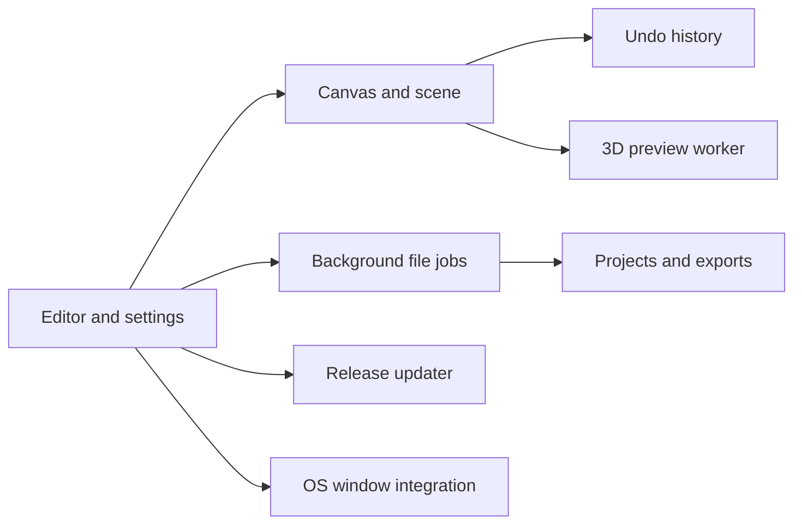

# Architecture

Ada3D is a Rust application using eframe/egui for native windows and interface rendering.

The document contains RGBA pixels and scene objects. Preferences, selected tools and window state are separate. History groups each drawing or transform gesture into one undo step.

File jobs and 3D previews run outside the UI thread. Workers send results back to the editor; stale preview results are discarded. Loading and export counters report completed work.

The updater checks GitHub releases once at startup or on request. It validates the version, platform package, size, checksum and archive paths before preparing an update. Installation waits for the editor to exit and keeps the previous executable as a rollback copy.

See the [source map](source-map.md) for file locations.

Surface paint lives with each scene object. The renderer produces object IDs and surface coordinates for visible fragments; editor tools use those coordinates without modifying canvas pixels. Surface maps are included in project validation and history memory accounting.
