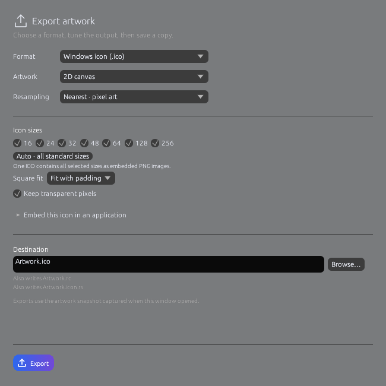

# Export artwork

Click **Export** in the title bar. Choose a format and destination in the export window, adjust its options, then click **Export**.

| Format | Use | Options |
|---|---|---|
| PNG | Images with transparency | Dimensions, resampling, compression, transparent or solid background |
| JPEG | Opaque images | Dimensions, resampling, quality and background color |
| ICO | Application icons | Multiple sizes, fit/crop/stretch and optional embedding helpers |
| OBJ | Editable 3D geometry | Scene geometry in world coordinates |

Choose **Canvas** for paint pixels or **Scene** for a rendered image containing the 3D objects. Nearest-neighbor resampling keeps pixel art sharp; smooth resampling suits continuous-tone images.

ICO can include 16, 24, 32, 48, 64, 128 and 256-pixel frames in one file. Optional `.rc` and Rust helper files let developers embed the icon in another application.

Export progress reflects encoding and file writing. Cancel stops unfinished work. Existing destinations require overwrite confirmation.

Use **Save** for an editable `.ada3dproject`; exported images do not retain scene objects or editing history.
