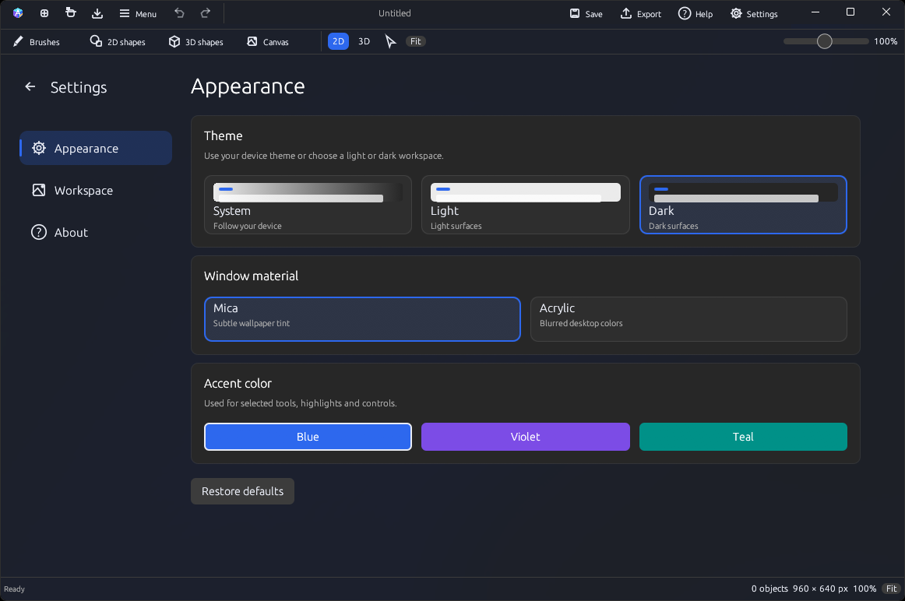
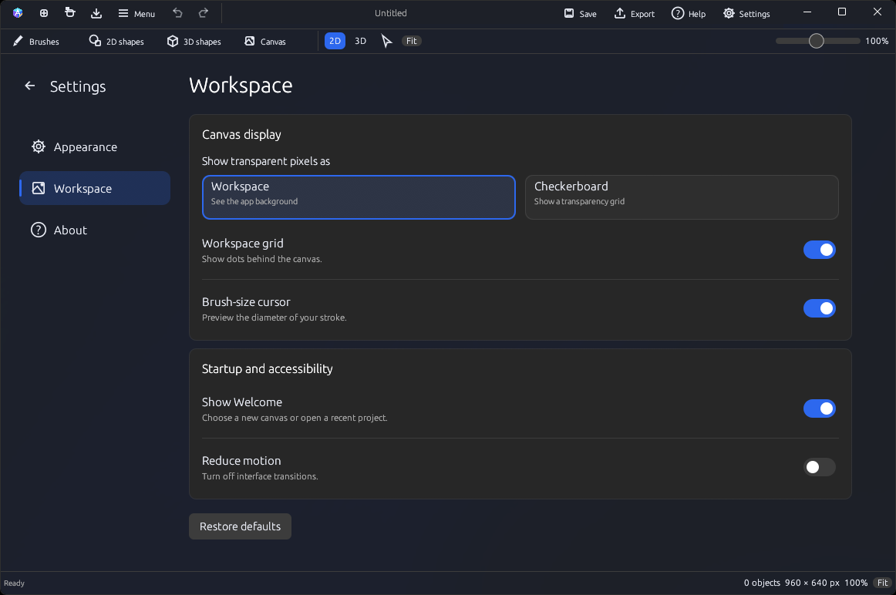
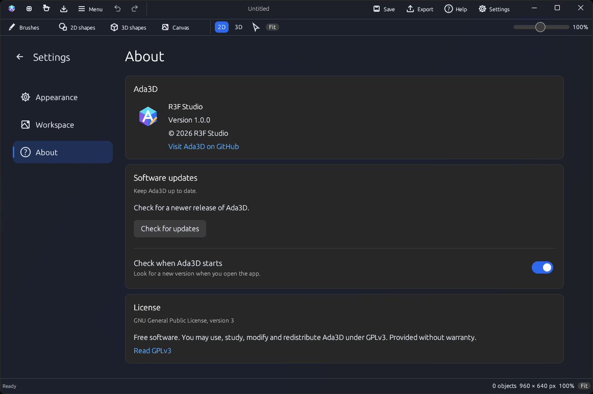

# Settings

Open **Settings** in the title bar. Choose a section on the left; the back arrow returns to your canvas.

- **Appearance:** choose a device, light or dark theme, window material and accent color. macOS uses native frosted glass; Linux uses desktop blur where supported.
- **Workspace:** adjust transparency display, the grid, brush cursor, Welcome and reduced motion.
- **About:** view the version, publisher and license, or check for updates. Startup checks can be turned on or off here.

Preferences are saved separately from projects. **Restore defaults** keeps your recent projects.

