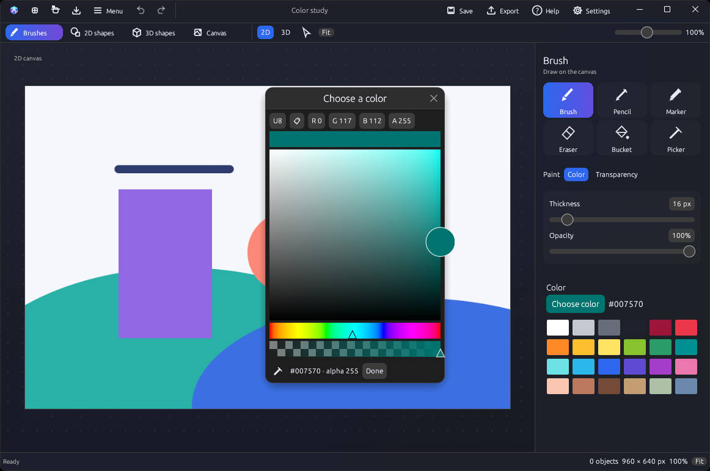
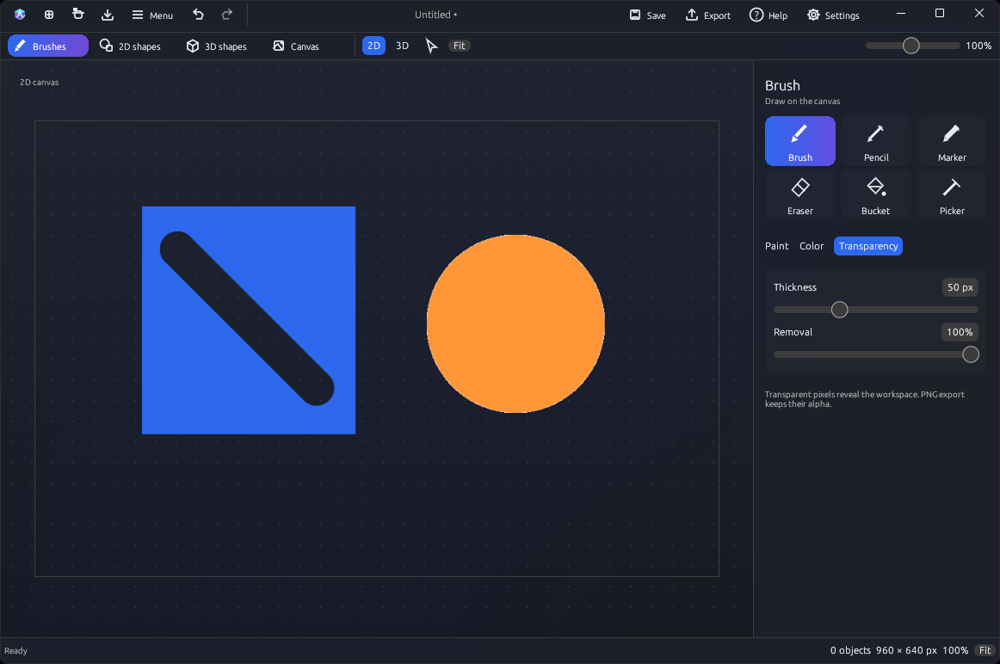
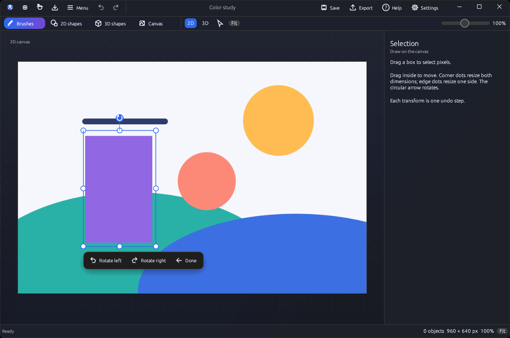
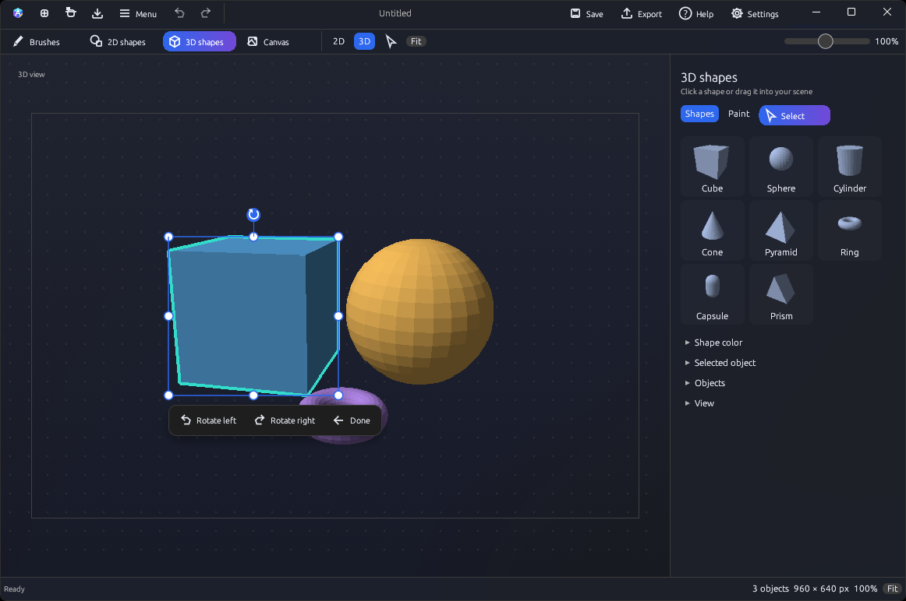
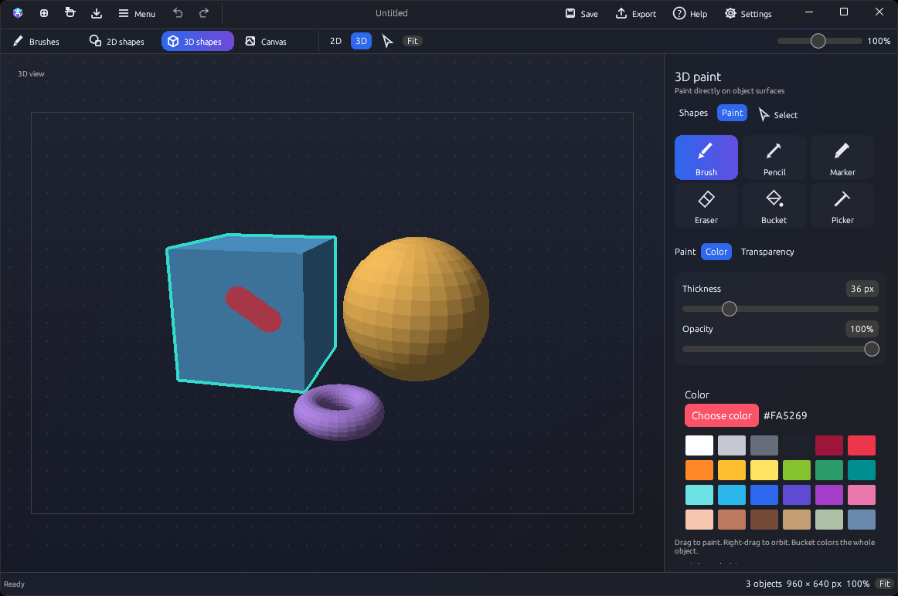
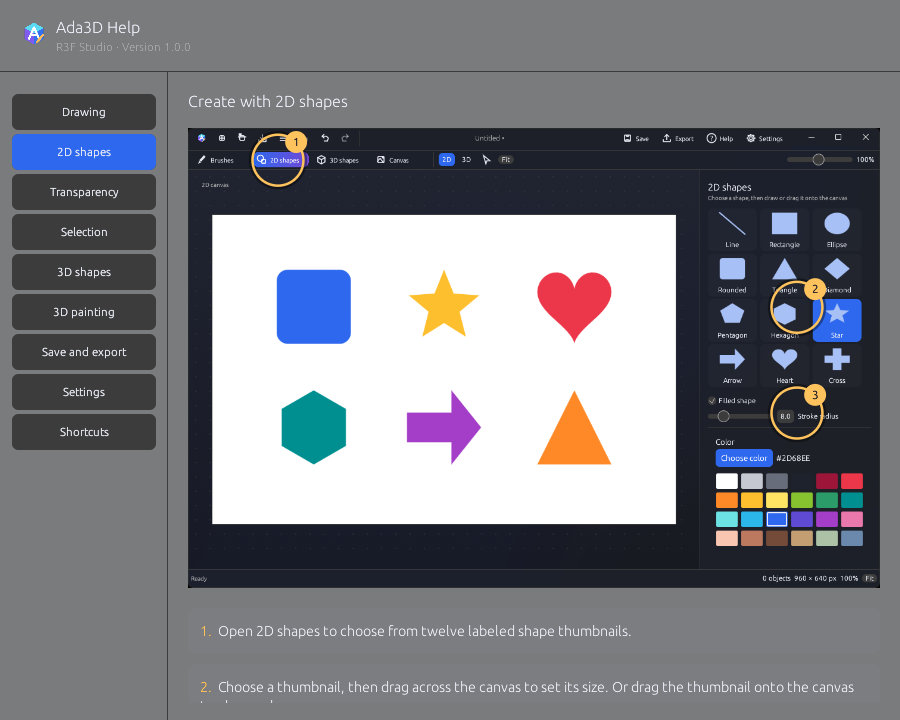
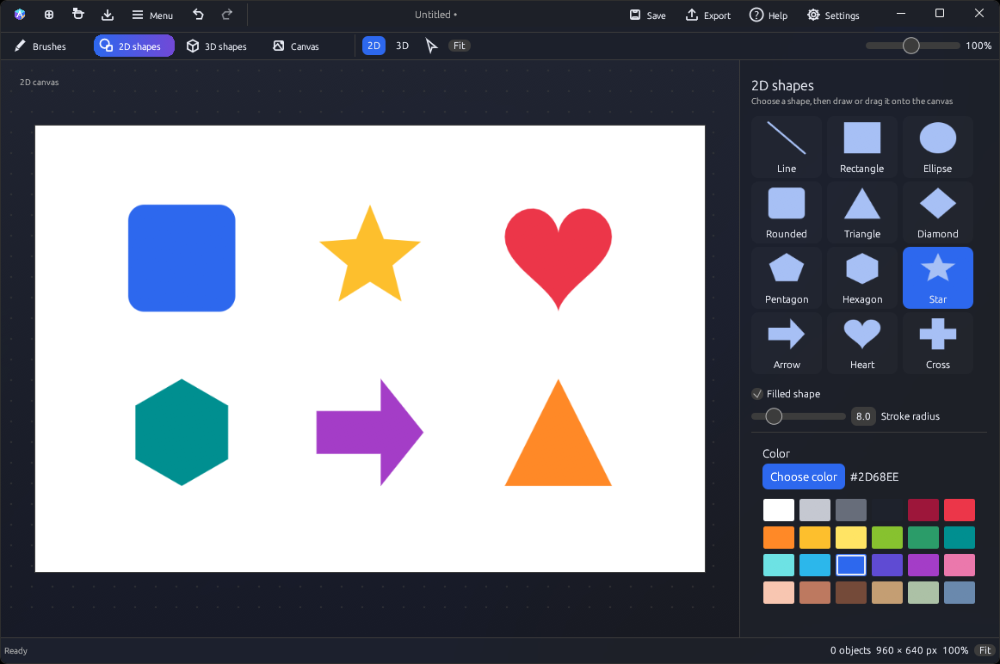

# Using Ada3D

## Start a project

Choose New on the welcome screen for a blank canvas. Open restores a saved .ada3dproject file. Import image brings a PNG or JPEG onto the canvas. Save keeps pixels and editable 3D objects together.

Projects use the **.ada3dproject** extension exclusively. PNG and JPEG are image imports. Export supports PNG, JPEG, ICO and OBJ.

Welcome lists recent projects with their icons. Click one to open it; reading, decoding and validation run in the background with measured progress. Clear list removes the shortcuts without deleting your files.

## Draw

Open Brushes, choose a tool, and drag on the canvas. Thickness changes stroke width; opacity changes how much paint is applied. Picker copies the RGBA value of a canvas pixel without painting.

Magnified images keep their pixel boundaries sharp, including small textures and skins.

Click Choose color to mix a color. The sampler icon closes the dialog while you pick a canvas pixel, then reopens it with the sampled value. Escape cancels sampling and returns to the dialog. Your previous editing tool is restored.

## Make an area transparent

In the brush panel, switch from Color to Transparency. A stroke removes opacity. Bucket removes it from a connected region. Removal at 100% clears the affected pixels; lower values leave partial opacity. Export paint as PNG to keep transparency.

## Select and transform

Choose the Select arrow or right-click the canvas and choose Select and transform. Drag a box around the area you want. Drag inside the box to move it. Four corner dots resize both dimensions; four edge dots resize one dimension. Resizing pixels keeps the opposite corner or edge fixed, including after rotation. The circular arrow rotates freely.

A small action bar stays beside the selection with quarter-turn rotation buttons and Done. You can keep using the handles while it is visible. Right-click also offers selection actions, with the outline and handles still visible behind the menu. Each transform is one undo step. In 3D, the controls transform the selected object.

## Build a scene

Choose **3D** to open the shape palette. Click a thumbnail to add a shape at the center, or drag it into place. Choose from Cube, Sphere, Cylinder, Cone, Pyramid, Ring, Capsule and Prism.

Use **Select** to move, scale or rotate an object. Expand **Selected object** for numeric controls. Right-drag orbits the camera; scroll zooms.

Choose **Paint** in the right panel, or click **Brushes** while in 3D. Brush, Pencil and Marker paint the visible surface. Thickness and opacity work like their 2D counterparts. Right-drag to reach the other sides.

**Bucket** colors the whole object. **Picker** samples its surface color. **Eraser** and **Transparency** remove surface opacity. Each stroke is one undo step, and painting leaves the 2D canvas untouched.

Save a **.ada3dproject** to keep shapes and their editable paint. Export a 3D scene PNG to keep its appearance and transparency; OBJ exports geometry. [More about 3D editing](3d-editing.md).

The title-bar Export button opens a native window for format, destination, image quality and icon-size options. See the [export guide](exporting.md).

## Navigate and save

| Action | Shortcut |
|---|---|
| New / Open / Save | Ctrl+N / Ctrl+O / Ctrl+S |
| Save as | Ctrl+Shift+S |
| Undo / Redo | Ctrl+Z / Ctrl+Shift+Z |
| Brush / Eraser / Bucket / Picker | B / E / F / I |
| Pan / Zoom | Middle-drag / Scroll |
| Cancel | Escape |

Use Command instead of Ctrl on macOS. Focused text fields keep their normal editing shortcuts. Help in the title bar opens an illustrated guide that can stay beside your project.

## Help

Open **Help** in the title bar for illustrated instructions. The guide stays open while you work.

## 2D shapes

Open **2D shapes** for lines, rectangles, ellipses, rounded rectangles, triangles, diamonds, pentagons, hexagons, stars, arrows, hearts and crosses. Choose a thumbnail and drag on the canvas to draw at any size, or drag a thumbnail onto the canvas to place it. Set the color, stroke radius and **Filled shape** before drawing. Use Select to transform its pixels afterward.

